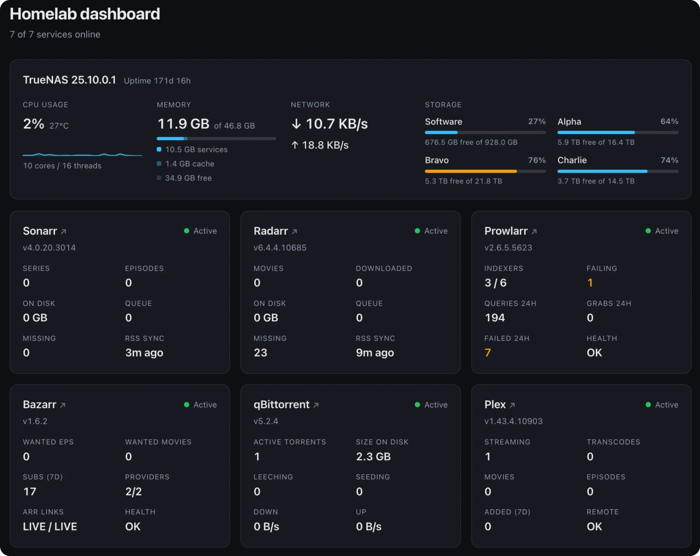

# hl-dashboard

One page for a self-hosted homelab, for seeing everything at a glance instead of opening multiple tabs.
Pulls live data from -arr apps plus a system panel for the NAS itself: CPU, memory, network and
per-pool storage.

Runs locally on a NAS. Personal project, built to get properly familiar with React and TypeScript.

WIP example below. Layout and panels are still changing.



### Stack

- React 19 + TypeScript, built with Vite
- TanStack Query for polling and caching
- Fastify back-end holding the API keys

```bash
npm run dev:server   # API proxy on :3030
npm run dev          # front-end on :5173
```

### Running on the NAS

Every push to `main` publishes `ghcr.io/larsbogerd/hl-dashboard:latest`.
In Dockge, create a stack from [`compose.yaml`](compose.yaml), paste your
`.env` into the stack's `.env` editor and start it. The dashboard is on
port 3030. To update, press **Update** in Dockge.
